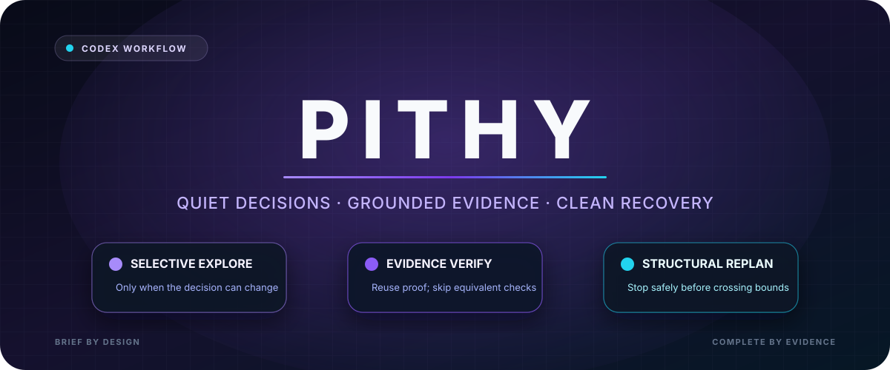
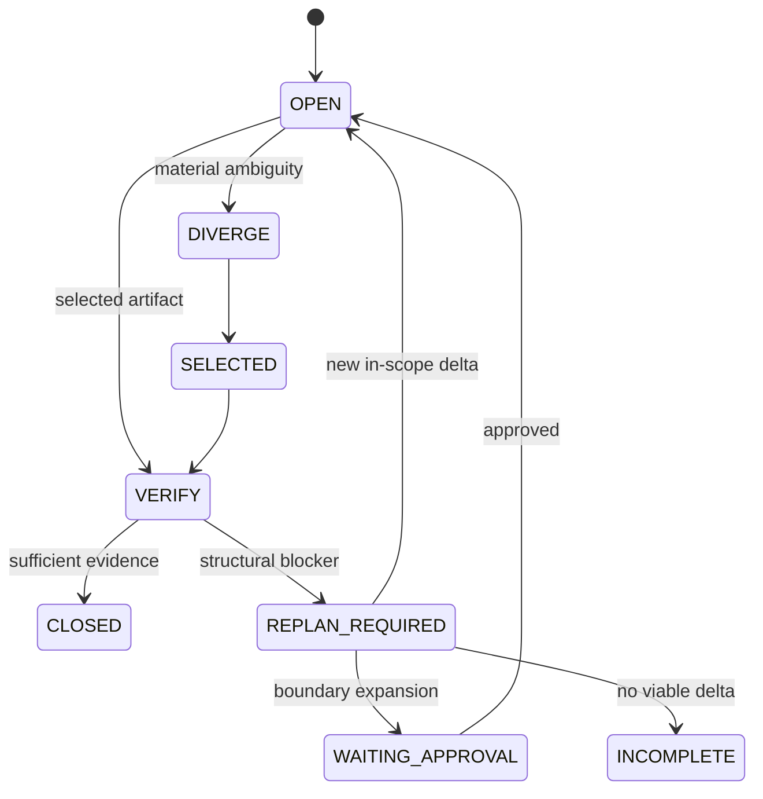

<p align="center">
  
</p>

<div align="center">

# Pithy

**Quiet decisions. Grounded evidence. Clean recovery.**

[](https://github.com/bellchu/pithy/actions/workflows/validate.yml)
[](./skills/pithy/SKILL.md)
[](./LICENSE)

Pithy is a Codex workflow skill for selective exploration, evidence-grounded verification, and structural replanning. Clear tasks stay direct; complex tasks get only the extra work that can change the decision.

</div>

## How it behaves

- **Select:** diverge only when competing mechanisms materially matter.
- **Verify:** reuse valid evidence and avoid equivalent re-checks.
- **Recover:** stop local patching when assumptions fail; request approval before crossing boundaries.



## Install

```bash
git clone https://github.com/bellchu/pithy.git
mkdir -p "${CODEX_HOME:-$HOME/.codex}/skills"
cp -R pithy/skills/pithy "${CODEX_HOME:-$HOME/.codex}/skills/"
```

Restart Codex or begin a new session, then invoke:

```text
$pithy compare approaches for this migration
$pithy verify this implementation against its acceptance criteria
```

## Design rule

> Add a branch, check, repair, or replan only when it can resolve a decision-relevant uncertainty.

Pithy favors low-noise communication and lower total work, but never uses brevity to hide material evidence, risk, or required authority.

## License

[MIT](./LICENSE) © 2026 Bell Zhu. The divergence pattern is adapted from [UditAkhourii/adhd](https://github.com/UditAkhourii/adhd) under MIT.
